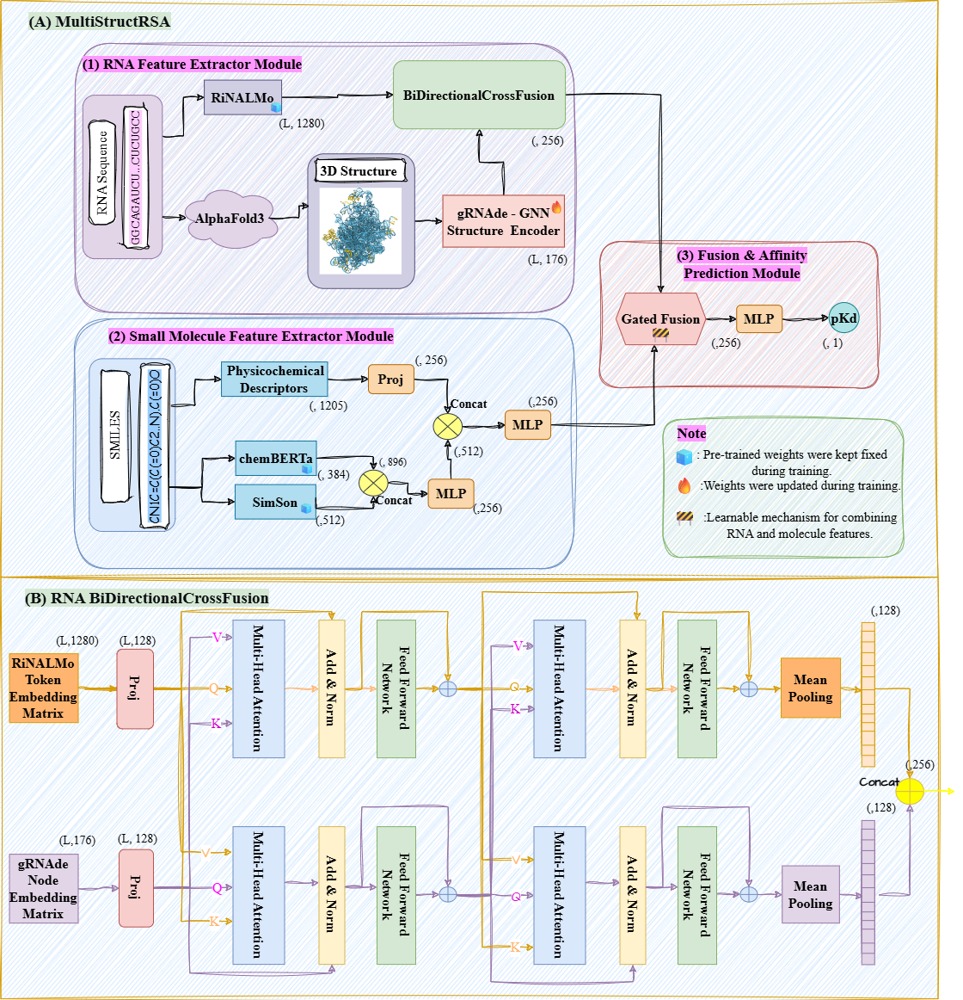

<h2 align="center">
  MultiStructRSA: <ins>Multi</ins>modal Prediction of <ins>R</ins>NA–<ins>S</ins>mall Molecule<br>
  Binding <ins>A</ins>ffinity Using Predicted RNA 3D <ins>Struct</ins>ure
</h2>


<p align="center">
  
</p>

MultiStructRSA predicts the binding affinity (`pKd`) of an RNA–small-molecule
pair. The RNA branch combines nucleotide-level RiNALMo embeddings with an RNA
3D graph produced from an AlphaFold3 structure and encoded by a pretrained
gRNAde GVP-GNN. A bidirectional cross-attention module fuses the RNA sequence
and structure representations. The molecular branch combines ChemBERTa,
SimSon, and Mordred features, and gated fusion joins the RNA and molecular
representations before regression.

This repository contains the R-SIM experiments used for model development,
including hyperparameter search, sensitivity and ablation studies, stratified
cross-validation, and RNA/molecule cold-start evaluation.

## Before running an experiment

Run commands from this directory (`Thesis/src`) in the project's Python
environment. A CUDA GPU is strongly recommended. The evaluation code expects
the following prepared artifacts to be present:

- R-SIM data under `datasets/RSIM/`;
- the five cold-start train/validation/test splits under
  `datasets/blind_test/{rna,mole,rm}/train_val_test_splits/`;
- precomputed RNA and molecule features under `embeddings/`;
- the pretrained gRNAde encoder at
  `saved_objects/gRNAde_checkpoints/gRNAde_drop3d@0.75_maxlen@500.h5`.

The runner scripts and commands below deliberately keep the final
MultiStructRSA configuration fixed. Users should choose only the evaluation
setting, fold count where supported, and a run tag used to name outputs.

### Fixed final configuration

| Component | Fixed value |
| --- | --- |
| Model | full MultiStructRSA; trainable gRNAde encoder |
| Active RNA inputs | RiNALMo and gRNAde (`ERNIE-RNA` excluded) |
| Active molecule inputs | ChemBERTa, SimSon, and Mordred (Morgan excluded) |
| Optimizer | Adam, learning rate `2e-5`, weight decay `1e-6` |
| Fusion | `d_model=128`, `ffn_mult=4`, 2 blocks, mean node/token pooling |
| Molecule encoders | deep sequence encoder, projection expert encoder |
| Regularization | dropout `0.1` |
| Batch size | `1` |

## Cold-start evaluation

Cold-start evaluation uses the five prepared folds. Choose one cold-start
type:

| CLI value | Evaluation condition |
| --- | --- |
| `cold_rna` | test RNAs are unseen during training |
| `cold_mole` | test molecules are unseen during training |
| `cold_rm` | both test RNAs and test molecules are unseen |

The number of cold-start folds is fixed at five by the prepared split files;
`--k_fold` does not change it.

### Runner script

Pass the cold-start type and a short run tag. A run tag may contain letters,
numbers, dots, and hyphens, but no underscores.

```bash
bash job_settings/run_cold_start.sh cold_rna run01
bash job_settings/run_cold_start.sh cold_mole run01
bash job_settings/run_cold_start.sh cold_rm run01
```

### Equivalent command line

Change only `COLD_TYPE` and `RUN_TAG`.

```bash
COLD_TYPE=cold_rna
RUN_TAG=run01

python main.py \
  --setting cold \
  --cold_type "$COLD_TYPE" \
  --exp_name "multistructrsa_${COLD_TYPE}_${RUN_TAG}" \
  --res_file_name "cold_${RUN_TAG}" \
  --log_file_name "cold_${RUN_TAG}" \
  --log_msg "MultiStructRSA cold-start evaluation: ${COLD_TYPE} (${RUN_TAG})" \
  --is_plot True \
  --plot_name "${RUN_TAG}_cold" \
  --model_setting full \
  --exclude_modalities morgan ernie \
  --train_setting 4 --val_setting 4 \
  --rna_aug False --mol_aug True --is_seq_emb False \
  --lr 2e-5 --wd 1e-6 --dropout 0.1 \
  --patience 20 --warm_up_epochs 10 --delta 1e-4 \
  --d_model 128 --ffn_mult 4 --bdcf_blocks 2 \
  --node_pool mean --token_pool mean \
  --smiles_seq_setting deep --smiles_expert_setting proj \
  --freeze_grnade False \
  --batch_size 1 --num_workers 0 \
  --device cuda --seed 2 --dataset_seed 2
```

## Stratified k-fold cross-validation

This experiment stratifies the complete R-SIM dataset by binding affinity.
Choose the number of folds and a run tag. Five folds reproduce the main
evaluation protocol; larger fold counts require proportionally more training.

### Runner script

```bash
bash job_settings/run_stratified_cv.sh 5 run01
```

### Equivalent command line

Change only `K_FOLD` and `RUN_TAG`.

```bash
K_FOLD=5
RUN_TAG=run01

python main.py \
  --setting cv \
  --cv_method all \
  --k_fold "$K_FOLD" \
  --exp_name "multistructrsa_stratified_${K_FOLD}fold_${RUN_TAG}" \
  --res_file_name "cv_${RUN_TAG}" \
  --save_predictions True \
  --log_file_name "cv_${RUN_TAG}" \
  --log_msg "MultiStructRSA stratified ${K_FOLD}-fold CV (${RUN_TAG})" \
  --is_plot True \
  --plot_name "${RUN_TAG}_cv" \
  --model_setting full \
  --exclude_modalities morgan ernie \
  --train_setting 4 --val_setting 4 \
  --rna_aug False --mol_aug True --is_seq_emb False \
  --lr 2e-5 --wd 1e-6 --dropout 0.1 \
  --patience 20 --warm_up_epochs 50 --delta 1e-6 \
  --d_model 128 --ffn_mult 4 --bdcf_blocks 2 \
  --node_pool mean --token_pool mean \
  --smiles_seq_setting deep --smiles_expert_setting proj \
  --freeze_grnade False \
  --batch_size 1 --num_workers 0 \
  --device cuda --seed 1 --dataset_seed 2
```

## Outputs

For a run tag such as `run01`, the commands above write:

| Output | Cold start | Stratified CV |
| --- | --- | --- |
| Metric summary | `results/table_results/cold_run01.csv` | `results/table_results/cv_run01.csv` |
| Per-fold predictions | not currently exported | `results/table_results/cv_run01/fold_*.csv` |
| Log | `results/logs/cold/cold_run01.log` | `results/logs/cv/cv_run01.log` |
| Loss/correlation plots | `results/plots/run01/cold/` | `results/plots/run01/cv/` |

Summary CSV files contain the mean, standard deviation, and per-fold values for
Pearson correlation, Spearman correlation, RMSE, and R². Reusing the same
result name appends another summary row, so use a new run tag when outputs
should remain separate.

Run `python main.py --help` to inspect the complete CLI. Options not shown as
user choices above are model or training hyperparameters and should remain at
the fixed values used by the runner scripts.
